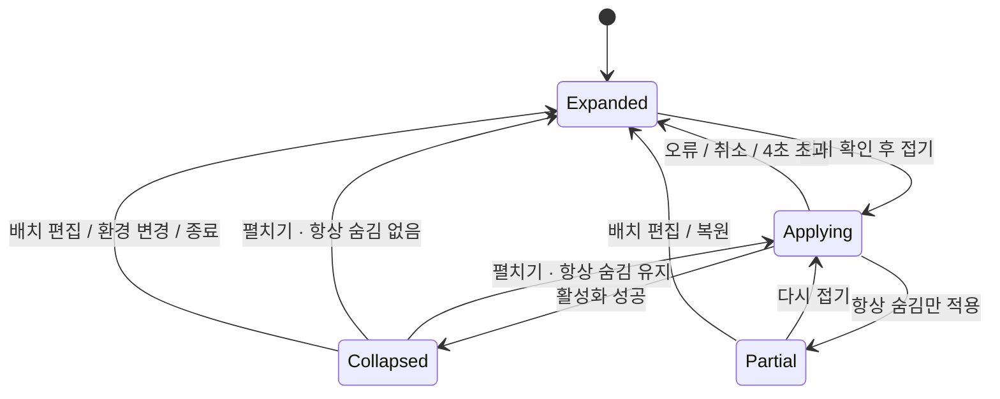

# 구조와 상태

## 모듈

| 파일 | 책임 |
| --- | --- |
| `QuietBarApp.swift` | 앱 생명주기, 설정 창, 중복 실행 방지 |
| `StatusBarController.swift` | 화살표·일반·점선 상태 항목, 위치 수집, 드래그 후 자동 반영, 자동 숨김 |
| `PreferencesView.swift` | 한국어 설정 UI와 단축키 녹화 |
| `Preferences.swift` | UserDefaults, `SMAppService` 로그인 항목 |
| `GlobalShortcut.swift` | Carbon `RegisterEventHotKey`, 충돌 보고 |
| `AccessibilityInventory.swift` | 앱별 `AXExtrasMenuBar`와 아이콘 위치 읽기 |
| `NativeVisibilityDriver.swift` | Swift 세션과 Objective-C 핸들 연결 |
| `Layout.swift` | 좌표 → 앱별 구역 결정, 항상 숨김을 보존하는 일반 구역 갱신, 드래그 판정 |
| `VisibilitySession.swift` | 비동기 활성화, 세대 번호, 핸들 교체·해제 |
| `VisibilityBridge.m` | 동적 로딩, selector 확인, Objective-C 예외 처리, 4초 제한 |

앱 타깃은 `Sources`의 Swift 파일과 ObjC 브리지를 직접 컴파일합니다. Swift Package는 `QuietBarCore`와 테스트만 컴파일합니다. 실제 메뉴 막대 없이 위치 분류와 세션 수명을 검증하기 위한 구분입니다.

## 상태 항목과 좌표

AppKit의 상태 항목 세 개를 사용합니다. 화살표는 토글, 일반 구분선은 숨김 경계, 선택적인 점선은 항상 숨김 경계입니다. macOS 27에서도 별도 일반 구분선을 유지해 참고 스크린샷의 배치 방식을 따릅니다. 각 항목의 `autosaveName`으로 macOS가 사용자의 위치를 기억합니다. 제거 허용 동작은 켜지 않습니다.

0.1.2부터 주 접기가 성공한 `Collapsed` 상태에서는 일반·점선 구분선의 버튼 이미지를 제거합니다. macOS 27에서는 두 항목의 `length`도 0으로 줄입니다. macOS 자체의 상태 항목 여백은 남을 수 있습니다. 항목은 제거하지 않고 `isVisible`도 끄지 않아 기존 슬롯과 저장 위치를 유지합니다. 화살표는 계속 표시합니다. 펼치기 성공(`Expanded` 또는 `Partial`), 배치 편집, 오류·취소에 따른 복원 때 두 구분선의 폭과 이미지를 복원합니다. `Applying` 동안에는 직전 확정 상태의 구분선 표시를 유지합니다. 일반 펼치기에서 점선이 다시 보여도 항상 숨김 구역의 앱은 계속 숨깁니다.

AppKit은 아래쪽이 원점이고 Accessibility는 위쪽이 원점입니다. `StatusItemGeometry`는 기본 디스플레이의 `maxY`로 상태 항목의 창 프레임과 화면 좌표를 AX 좌표로 변환합니다. macOS 27의 버튼 내부 좌표 및 호스팅 중의 `window.screen` 연관 정보에 의존하지 않고, 창 중앙이 포함된 화면을 고릅니다. 기본 화면보다 높은 디스플레이의 AX 좌표는 음수일 수 있습니다. 분류기는 경계가 속한 화면 및 같은 메뉴 막대 높이에 있는 유효한 아이콘만 취급합니다. RTL에서는 숨김 방향을 뒤집습니다.

같은 번들의 아이콘이 여러 구역에 있으면 `항상 표시 > 숨김 > 항상 숨김`을 적용합니다. 시스템 앱(`com.apple.*`), 자기 자신, 빈 식별자, 잘못된 프레임은 숨김 후보에서 제외합니다. AX 읽기에 실패한 앱도 기본 표시합니다.

읽기는 메인 스레드 밖에서 실행합니다. 실행 중인 `.app` 번들만 조사하고 AX 메시지 제한은 앱별 0.1초입니다. 수집 전후 구분선 위치가 달라졌다면 결과를 사용하지 않습니다. 사용자가 수집 중 복원을 누르면 요청 세대가 달라져 결과가 폐기됩니다.

## macOS 27 상태 전이

`arranging`은 컨트롤러의 별도 편집 상태입니다. 설정 창을 열거나 복원하면 모든 제한을 해제하고 이 상태로 돌아갑니다. 첫 시작도 편집 상태입니다. ⌘-드래그로 구역을 바꾸면 자동으로 적용하며, 기존 배치를 다시 적용할 때는 화살표를 사용합니다.

숨김 요청은 **실행 중인 모든 앱 − 숨길 앱 + 자기 자신**을 허용 목록으로 보냅니다. 시스템 항목은 별도 숫자 식별자 0–63도 허용합니다. 알 수 없는 앱을 허용해 AX 결과 누락으로 숨겨지는 범위를 줄입니다.

새 세션이 성공한 뒤 기존 세션을 해제해 중간에 전체 표시가 번쩍이는 것을 줄입니다. 각 요청에는 세대 번호가 있습니다. 복원이나 더 새로운 요청 뒤 도착한 성공 핸들은 즉시 해제합니다. 활성화 실패 시 기존 세션도 해제하고 전체 표시합니다.

일반 접기·펼치기는 캐시된 구역을 사용합니다. 완전히 숨긴 앱의 AX 좌표는 신뢰하지 않습니다. `Partial` 상태에서 ⌘-드래그한 경우에는 `LayoutResolver.refreshingOrdinary`가 캐시의 `alwaysHidden` 번들 목록을 고정하고, 그 앱들의 AX 항목을 제외한 뒤 일반 숨김·표시 구역만 새로 읽습니다. 항상 숨김 앱이 AX에서 누락되거나 오래된 좌표로 나타나도 일반 구역으로 이동시키지 않습니다. 전체 표시 상태에서는 기존 세 구역 분류기를 사용하므로 항상 숨김 대상을 다시 배치할 수 있습니다. 앱 실행/종료, 디스플레이 변경 시 캐시를 버리고 전체 표시합니다.

## 드래그 후 자동 반영

`NSEvent`의 로컬·전역 마우스 모니터로 왼쪽 버튼 누름·드래그·놓기를 관찰합니다. 이벤트는 소비하거나 수정하지 않습니다. ⌘ 키를 누른 채 메뉴 막대 안에서 시작한 조작만 추적하고, 시작점에서 최소 4pt 이동해야 드래그로 판정합니다. 일반 클릭이나 창 드래그는 반영 요청을 만들지 않습니다. 접힌 상태 및 다른 숨김 적용 중에는 새로운 배치 드래그를 시작하지 않습니다.

마우스를 놓아도 ⌘ 키가 눌린 동안은 기다립니다. 여러 아이콘을 연속 배치한 뒤 마우스와 ⌘ 키를 모두 놓고 350ms가 지나면 AX 위치를 새로 수집합니다. 수집 중 입력을 다시 시작하면 다음 키 해제까지 기다리고, 구분선이나 화면 위치가 수집 전후 달라지면 200ms 뒤 한 번 재시도합니다. 여전히 불안정하면 현재 제한을 유지하며 자동 적용을 보류합니다.

분류가 바뀌면 새 제한을 적용해 접습니다. 분류가 같으면 현재 표시 상태를 유지합니다. 숨김 대상이 없어지면 제한을 해제합니다. 이 명시적인 드래그 반영은 설정 창 표시 여부·포인터 위치·자동 숨김 시간 설정과 별개입니다. 수동 접기·펼치기·복원·설정 변경·종료는 대기 작업을 취소하고 세대 번호를 바꿔 이전 위치 수집 결과가 뒤늦게 적용되지 않게 합니다. 종료할 때 로컬·전역 마우스 모니터도 제거합니다.

## 이전 OS

macOS 13–26에서는 일반 구분선 길이를 `min(10000, max(500, 가장 넓은 화면 폭 × 2))`로 늘립니다. 왼쪽 아이콘을 화면 밖으로 미는 기존 방법입니다. 주 접기 때 일반·점선 구분선의 이미지는 숨기되, 아이콘을 밀어내는 데 필요한 확장 길이는 유지합니다. 일반 펼치기 중에는 항상 숨김 구분선만 확장하고 두 구분선 이미지를 복원합니다. 화면 변경 시 전체 표시로 복원합니다. 노치 뒤에 가려진 아이콘을 별도 행으로 꺼내는 기능은 없습니다.

## 펼칠 때 메뉴 공간 확보

`펼칠 때 메뉴 막대 전체 사용`은 기본 비활성입니다. 설정 창이 닫힌 상태에서 일반 구역을 펼칠 때 Quiet Bar를 활성화해 전면 앱의 긴 메뉴 대신 Quiet Bar의 짧은 앱 메뉴를 표시합니다. OS의 메뉴 영역을 강제로 제거하거나 아이콘을 별도 행으로 옮기지는 않습니다.

공간 확보를 위해 활성화하기 직전의 앱을 기억합니다. 접기·복원 때 Quiet Bar가 계속 전면이면 해당 앱으로 포커스를 돌리고, 사용자가 이미 다른 앱으로 전환했다면 포커스를 변경하지 않습니다. 이 옵션으로 Quiet Bar가 활성화된 경우에는 시간에 따른 자동 숨김을 자기 앱이 활성 상태라는 이유로 계속 연기하지 않습니다.

## 설정과 진단

일반 탭은 구역 안내와 사용자 설정, 정보 탭은 앱 이름·아이콘·버전 및 웹·GitHub·이메일 링크를 표시합니다. 호환성·개인정보·구조 설명은 문서로 관리합니다. 상세 진단은 화살표를 ⌥-우클릭해 나타나는 `진단 정보…` 지원 메뉴에서 별도 창으로 표시합니다. 진단은 실행 앱이 인식한 AX 권한, 상태 항목·화면 좌표, 최근 AX 수집과 구역 분류, 드래그 상태를 담으며 외부로 전송하지 않습니다.

## 타이머와 단축키

시간에 따른 자동 숨김은 일회성 타이머입니다. 배치 편집, 설정 창 표시, 숨김 적용 중에는 시작하지 않습니다. 포인터가 메뉴 막대 위에 있거나 마우스를 누르고 있으면 다시 기다립니다. 앱이 일반적인 설정 조작으로 활성 상태인 경우에도 기다리되, 메뉴 공간 확보 옵션으로 활성화한 경우는 예외입니다. 다른 앱의 열린 드롭다운을 AX로 추적하지는 않습니다.

전역 단축키는 Carbon의 지정 조합 이벤트만 받습니다. 일반 키 입력을 전역 수집하지 않습니다. 배치 드래그 반영은 마우스 이벤트와 현재 ⌘ 키 누름 상태만 확인합니다. 녹화 중에만 설정 창의 로컬 키 이벤트를 관찰하고 기존 전역 등록은 잠시 해제합니다.

## 저장과 종료

설정은 `local.quietbar.app`의 UserDefaults에 저장합니다. 메뉴 막대 위치는 AppKit이 저장합니다. 로그인 실행은 시스템의 `SMAppService`가 관리하며 설정과 동기화합니다. 정상 종료 시 타이머·키 등록·상태 항목·숨김 세션을 정리합니다. 프로세스 종료 시 시스템이 제한을 해제하는 동작에 대한 실제 장치 확인은 수동 검증 항목입니다.
